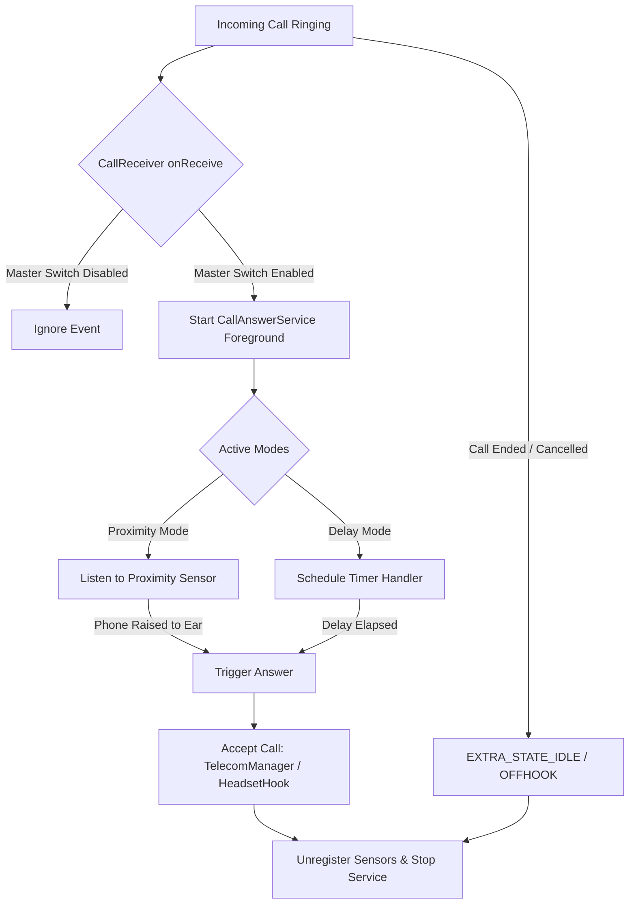

# Auto Call Answer (Autocall)

[](https://developer.android.com)
[](https://kotlinlang.org)
[-informational?style=flat-square)](https://developer.android.com/about/dashboards)
[-informational?style=flat-square)](https://developer.android.com/about/versions/13)
[](LICENSE)
[](https://github.com/nitinvishway/Autocall/pulls)

**Auto Call Answer** is a lightweight, privacy-focused Android utility application designed to automatically answer incoming phone calls using smart device sensors or configurable delay timers. Whether you are driving, wearing gloves, working in the kitchen, or just want a seamless hands-free experience, Auto Call Answer handles your calls automatically without requiring you to touch the screen.

---

## Table of Contents

- [Features](#features)
- [How It Works](#how-it-works)
- [Architecture & Tech Stack](#architecture--tech-stack)
- [Permissions & Privacy](#permissions--privacy)
- [OEM & Battery Optimization Guide](#oem--battery-optimization-guide)
- [Getting Started](#getting-started)
  - [Prerequisites](#prerequisites)
  - [Build and Run](#build-and-run)
- [Project Structure](#project-structure)
- [Contributing](#contributing)
- [License & Disclaimer](#license--disclaimer)

---

## Features

- **Raise-to-Ear Auto Answer (Proximity Sensor)**  
  Automatically answers incoming calls the moment you lift the phone to your ear. It reads the device's hardware proximity sensor (`Sensor.TYPE_PROXIMITY`), simulating the natural behavior of answering a call.

- **Configurable Delay Timer**  
  Answer incoming calls after a user-defined delay (in seconds). Perfect for hands-free scenarios where you want a few seconds of ringtone alert before the call connects.

- **Hybrid "First-to-Fire" Trigger**  
  Both proximity detection and timer delay can be enabled at the same time. Whichever condition is met first answers the call and automatically dismisses the other.

- **Zero Idle Battery Consumption**  
  The application does **not** keep a persistent background service running 24/7. It relies on a broadcast receiver that only activates the service when an incoming call is actively ringing, and immediately shuts down once the call is connected or terminated.

- **Dual-Engine Answering Strategy**  
  - **Modern Devices (Android 8.0+ / API 26+)**: Directly interfaces with Android's official `TelecomManager.acceptRingingCall()`.
  - **Legacy Fallback**: Dispatches simulated headset hook media key events (`KEYCODE_HEADSETHOOK`) via `AudioManager` for maximum device compatibility.

---

## How It Works



1. **Broadcast Interception**: Android broadcasts `TelephonyManager.ACTION_PHONE_STATE_CHANGED`. The `CallReceiver` receives this signal.
2. **State Validation**: If the call state is `EXTRA_STATE_RINGING` and auto-answer is turned on in preferences, `CallAnswerService` is launched as a lightweight foreground service.
3. **Sensor/Timer Monitoring**:
   - If proximity is enabled, the service registers a `SensorEventListener` on `Sensor.TYPE_PROXIMITY`.
   - If delay is enabled, a `Handler` posts a delayed execution block.
4. **Call Acceptance**: The first trigger to fire executes `answerCall()`.
5. **Teardown**: The sensor listener is detached, pending timer callbacks are cleared, and `stopForeground()` / `stopSelf()` are called to free up system resources.

---

## Architecture & Tech Stack

- **Language**: Kotlin 1.9.10
- **Android Architecture Components**:
  - `AndroidX Core KTX` (v1.12.0)
  - `AppCompat` (v1.6.1)
  - `Google Material Components` (v1.11.0)
- **Target Android Version**: Min SDK 21 (Android 5.0 Lollipop) to Target SDK 33 / Compile SDK 34 (Android 14)
- **Build System**: Gradle 8.4 with Android Gradle Plugin (AGP) 8.1.2

### Key Components

| Component | Class | Description |
| :--- | :--- | :--- |
| **UI & Configuration** | `MainActivity.kt` | Manages toggle states, delay inputs, and modern runtime permission requests (`ActivityResultContracts`). |
| **State Receiver** | `CallReceiver.kt` | Listens for telephony state transitions (`RINGING`, `OFFHOOK`, `IDLE`). |
| **Background Orchestration** | `CallAnswerService.kt` | Foreground lifecycle service hosting proximity sensor events and delay timers. |
| **Data Storage** | `Prefs.kt` | Lightweight persistence abstraction over Android `SharedPreferences`. |

---

## Permissions & Privacy

This application is built with security and privacy as first-class citizens. **No audio is recorded, no call logs are stored, and no data is ever transmitted over the internet.**

| Permission | Purpose |
| :--- | :--- |
| `READ_PHONE_STATE` | Detect incoming calls and determine current telephony status (`RINGING`, `OFFHOOK`, `IDLE`). |
| `ANSWER_PHONE_CALLS` | Programmatically accept incoming calls via `TelecomManager` on Android 8.0 (API 26) and above. |
| `MODIFY_AUDIO_SETTINGS` | Fallback audio routing and headset event dispatching on legacy Android systems. |
| `FOREGROUND_SERVICE` | Ensures the answer service stays alive during the ring duration without being terminated by OS task managers. |
| `POST_NOTIFICATIONS` | Required on Android 13 (API 33)+ to display the mandatory foreground service notification while the phone is ringing. |

---

## OEM & Battery Optimization Guide

Modern Android distributions (especially custom vendor skins) employ aggressive background battery management policies that may terminate broadcast receivers or background services.

If incoming calls do not trigger auto-answer reliably on your device:

<details>
<summary><b>Xiaomi / Redmi / POCO (MIUI / HyperOS)</b></summary>

1. Go to **Settings** > **Apps** > **Manage apps** > **Auto Call Answer**.
2. Enable **Autostart**.
3. Under **Battery Saver**, select **No restrictions**.
4. Lock the app in the recent apps tray if needed.
</details>

<details>
<summary><b>Samsung (One UI)</b></summary>

1. Go to **Settings** > **Battery and device care** > **Battery**.
2. Tap **Background usage limits** and ensure **Auto Call Answer** is added to **Never sleeping apps**.
3. In app info, verify **Appear on top** / **Change system settings** are enabled if prompted.
</details>

<details>
<summary><b>OnePlus / Oppo / Realme (OxygenOS / ColorOS)</b></summary>

1. Go to **Settings** > **Battery** > **Battery optimization** / **App battery management**.
2. Locate **Auto Call Answer** and toggle **Allow background activity** and **Don't optimize**.
3. Enable **Auto-launch** in Startup settings.
</details>

<details>
<summary><b>Huawei / Honor (EMUI / MagicOS)</b></summary>

1. Go to **Settings** > **Battery** > **App launch**.
2. Find **Auto Call Answer**, switch from **Manage automatically** to **Manage manually**.
3. Check **Auto-launch**, **Secondary launch**, and **Run in background**.
</details>

For more detailed vendor-specific guidelines, consult [Don't Kill My App!](https://dontkillmyapp.com/).

---

## Getting Started

### Prerequisites

- [Android Studio](https://developer.android.com/studio) (Hedgehog 2023.1.1 or newer recommended)
- Android SDK with platform tools for API level 34
- JDK 17 (recommended for Gradle 8+)
- A physical Android device with telephone capabilities (an emulator cannot reliably simulate phone calls with hardware proximity sensors)

### Build and Run

1. **Clone the repository:**
   ```bash
   git clone https://github.com/nitinvishway/Autocall.git
   cd Autocall
   ```

2. **Open in Android Studio:**
   - Launch Android Studio.
   - Select **Open**, navigate to the cloned folder `Autocall`, and click **OK**.
   - Allow Gradle to sync dependencies.

3. **Build the Debug APK via CLI:**
   ```bash
   # On Windows (PowerShell/CMD)
   gradlew assembleDebug

   # On macOS/Linux
   ./gradlew assembleDebug
   ```
   The resulting APK will be generated at:
   `app/build/outputs/apk/debug/app-debug.apk`

4. **Install on your connected device:**
   ```bash
   adb install -r app/build/outputs/apk/debug/app-debug.apk
   ```

---

## Project Structure

```text
Autocall/
├── app/
│   ├── src/
│   │   └── main/
│   │       ├── java/com/example/autocallanswer/
│   │       │   ├── CallAnswerService.kt  # Proximity & delay handling foreground service
│   │       │   ├── CallReceiver.kt       # BroadcastReceiver for phone state updates
│   │       │   ├── MainActivity.kt       # Main UI screen & permission requests
│   │       │   └── Prefs.kt              # SharedPreferences key definitions
│   │       ├── res/
│   │       │   ├── layout/activity_main.xml # Clean, single-screen UI layout
│   │       │   └── values/               # Strings, themes, and styling
│   │       └── AndroidManifest.xml       # Permissions, receivers, and service declaration
│   ├── build.gradle                      # App-level module configuration
│   └── proguard-rules.pro
├── gradle/wrapper/                       # Gradle wrapper configuration (v8.4)
├── build.gradle                          # Top-level build configuration
├── settings.gradle                       # Project settings
└── README.md                             # Project documentation
```

---

## Contributing

Contributions, feature requests, and bug reports are welcome!

1. **Fork the Project** (`https://github.com/nitinvishway/Autocall/fork`)
2. **Create a Feature Branch** (`git checkout -b feature/AmazingFeature`)
3. **Commit your Changes** (`git commit -m 'Add some AmazingFeature'`)
4. **Push to the Branch** (`git push origin feature/AmazingFeature`)
5. **Open a Pull Request**

---

## License & Disclaimer

This project is licensed under the MIT License - see the [LICENSE](LICENSE) file for details.

### Disclaimer
> [!IMPORTANT]
> This application is intended to assist with hands-free operation in safe environments. **Always prioritize safety while operating motor vehicles or machinery.** The developers assume no responsibility for calls answered unintentionally, missed calls due to OEM battery management restrictions, or improper use while driving.
